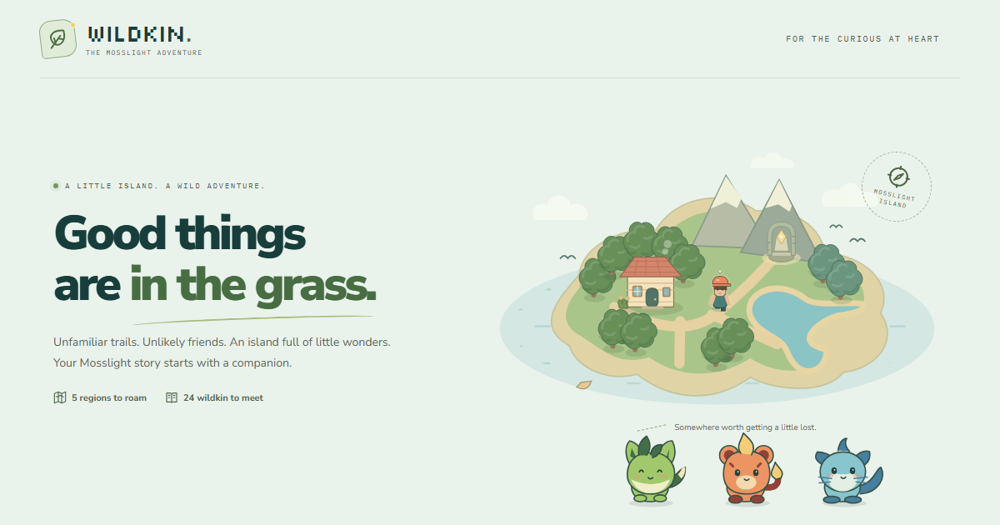
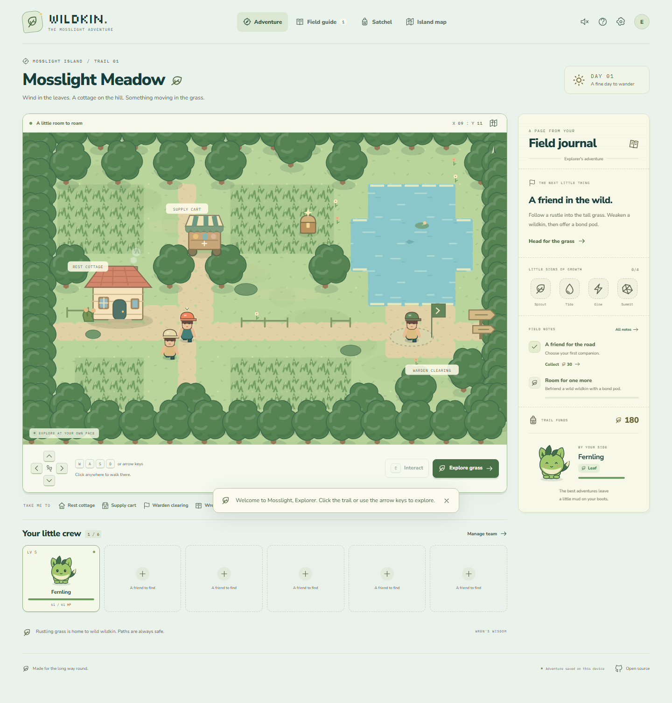
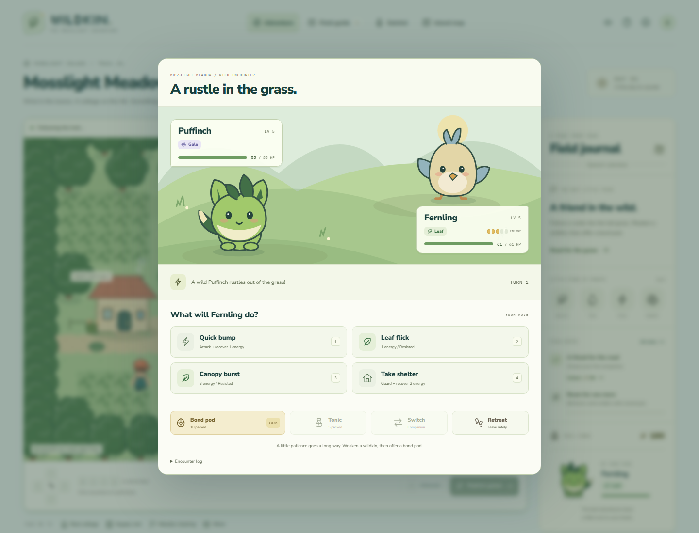

# Wildkin: Mosslight

**A little island. A wild adventure.**

An original monster-catching browser RPG about unfamiliar trails, unlikely friends, and taking the long way round.

## [Play the game](https://xavierxmorris.github.io/wildkin-mosslight/)

[](https://xavierxmorris.github.io/wildkin-mosslight/)

Choose Fernling, Cindercub, or Ripplefin. Explore Mosslight, befriend wild creatures, earn four warden seals, and meet the light at the heart of the island.

No account. No payments. No timers. No external game-data service.

## A complete little adventure

| Explore | Befriend | Grow |
| --- | --- | --- |
| Five regions with walkable maps, collision, and click-to-walk pathfinding | 24 original wildkin with hand-authored SVG artwork and field notes | Six evolution lines and whole-team experience |
| Cottages, traveling shops, caches, and conversations | Three starters, all also discoverable in the wild | Four multi-companion warden battles |
| Keyboard and held touch controls | Six active companions plus 120 reserve spaces | A guardian encounter, ending, and continued exploration |
| Eight rewarding field-note milestones | Rare luminous variants and starlight lures | Six elements, an in-game matchup chart, and tactical energy management |

Encounters, damage, capture odds, progression, shopping, and saves are functional game systems, not mock UI.



## How to play

1. Choose a starter and give your explorer a name.
2. Click **Explore grass**, click the map, or move with the direction controls. Paths are safe; tall grass holds wildkin.
3. In an encounter, weaken a wildkin and offer a **Bond pod**. The displayed chance improves as its health falls.
4. **Quick bump** restores one energy. **Take shelter** restores two and halves the opponent's next hit. Elemental moves spend energy.
5. Visit a **Rest cottage** to heal your entire collection for free. Tonics restore 55 HP and can wake a fainted companion.
6. Meet Rowan in the meadow, Marin at the shore, Iris in the grove, and Flint at the summit. Each seal unlocks the next region.
7. Bring all four seals to Firstlight Sanctuary. At 25% health or less, Solume always accepts a bond pod. If it faints, return to the altar and try again.

Every team companion gains experience, including those who did not take a turn. New friends beyond the six-member team go to the reserve sanctuary, never disappear. Defeat brings the team safely to a shelter; it does not delete companions.

### Controls

| Input | Action |
| --- | --- |
| Arrow keys or `W A S D` | Walk |
| Click the ground | Follow a valid path |
| Click a landmark or a trail shortcut | Walk there and interact |
| Hold a direction button | Keep walking on mouse or touch devices |
| `E` or `Space` | Interact with a nearby landmark |
| `1` through `4` | Choose a battle move |
| `M` | Island map |
| `J` | Field guide |
| `B` | Satchel |
| `T` | Team and reserves |
| `Escape` | Close a menu; active battles require Retreat instead |

Keyboard shortcuts do not run while typing or behind a modal. Sound is opt-in. Calm mode and the operating system's reduced-motion preference disable decorative animation.



## Saves, privacy, and offline play

- **Autosave:** the browser stores progress after every game action, including the exact current battle and random stream.
- **Portable adventures:** Settings can export a JSON backup or import one after an explicit replacement confirmation.
- **Recovery:** invalid saves are not silently replaced. The original file can be downloaded for recovery. Storage restrictions and quota failures are surfaced.
- **Offline:** open the production game online and wait for **Ready for offline wandering**. Subsequent reloads and gameplay work without a network connection.
- **Updates:** a new service worker waits rather than interrupting a session. **Save and update** persists the current adventure before reloading.
- **Install:** supported browsers offer their normal Install / Add to Home Screen action.

The application has no authentication, analytics, advertising, multiplayer, or backend. Hosting infrastructure still serves normal HTTP requests. Saves belong to one browser profile and origin; clearing site data removes that browser's copy. Export before switching devices or browsers, and avoid simultaneously editing the same adventure in multiple tabs.

Offline caching is enabled for production builds only. Browsers can evict site storage; an exported save is the durable backup.

## Run locally

Use **Node.js 24.x** (recommended; local development used 24.13.0) and npm.

```powershell
git clone https://github.com/xavierxmorris/wildkin-mosslight.git
Set-Location .\wildkin-mosslight
npm ci
npm run dev
```

Open the URL printed by Vite, normally **http://localhost:5173/wildkin-mosslight/**.

```powershell
npm run build
npm run preview
```

The production output is in `dist`. The preview server is for local use, not a production application server. HTTPS or localhost is required for service workers.

### Development commands

```powershell
npm run lint
npm run test
npm run build

# One-time browser setup on a new development machine:
npx playwright install chromium

# Builds first, then runs desktop/mobile, accessibility, and offline scenarios:
npm run test:e2e
```

`npm run check` combines lint, unit tests, and a production build. The browser suite manages development and production-preview servers on ports **4173** and **4174**. Those ports are reserved for these tests.

Coverage includes deterministic full campaigns from **each starter** through all wardens and the guardian; battle turns, capture, evolution, reserve capacity, economy, progression locks, invalid saves, import/export, modal focus, keyboard/touch controls, and offline reloads. Axe audits cover welcome, adventure, guide, team, bag, map, journal, settings, help, and battle. Automated accessibility checks are not a substitute for a complete assistive-technology review.

## Project guide

| Path | Responsibility |
| --- | --- |
| `src/game/types.ts` | Game-state and action contracts; stable content identifiers |
| `src/game/data.ts` | Species, elements, moves, regions, wardens, items, and quests |
| `src/game/world.ts` | Tile maps, collision, proximity, and breadth-first pathfinding |
| `src/game/engine.ts` | Pure reducer, seeded randomness, battles, capture, growth, and progression |
| `src/game/persistence.ts` | Versioned saves, structural and semantic validation, storage failures |
| `src/GameApp.tsx` | Input, navigation, autosaving, and screen orchestration |
| `src/components` | Original SVG art, map rendering, dialogs, and game interfaces |
| `src/audio.ts` | Original opt-in Web Audio tones and ambient sequence |
| `build/offline.ts` | Build-derived precache manifest and isolated service worker |
| `e2e` | Real-browser interaction, accessibility, and production/offline tests |

See [the design and game-system notes](docs/GAME-DESIGN.md) for balancing rules and invariants.

## Deployment

GitHub Actions runs the quality gates, packages `dist`, and deploys the `main` branch to GitHub Pages. Pull requests run the same checks without publishing.

The repository's **Settings > Pages > Source** must be **GitHub Actions**. The deployment base is `/wildkin-mosslight/` in `vite.config.ts`. If you rename or fork the repository, update that base and the absolute social/source links in `index.html` and the application. Manifest scope, start URL, and the service-worker precache derive from the configured deployment.

Actions are pinned to immutable revisions, and only the deployment job receives Pages write and OIDC permissions.

### Dependency and documentation snapshot

Verified from the installed dependency graph and current official sources on **2026-09-07**. `package-lock.json` is authoritative.

| Component | Version | Reference |
| --- | --- | --- |
| React / React DOM | 19.2.8 | [React reducer reference](https://react.dev/reference/react/useReducer) |
| Vite | 8.2.2 | [Versioned static deployment guide](https://github.com/vitejs/vite/blob/v8.2.2/docs/guide/static-deploy.md) |
| TypeScript | 6.0.3 | [npm package](https://www.npmjs.com/package/typescript/v/6.0.3) |
| Zod | 4.5.4 | [npm package](https://www.npmjs.com/package/zod/v/4.5.4) |
| Vitest | 4.1.11 | [Stable v4 package](https://www.npmjs.com/package/vitest/v/4.1.11) |
| Playwright | 1.63.0 | [npm package](https://www.npmjs.com/package/@playwright/test/v/1.63.0) |
| Fontsource packages | 5.3.0 | [Fontsource](https://fontsource.org/) |

The stable Vitest v4 line is used intentionally instead of the `latest` tag's v5 release candidate at the time of creation.

## Originality and license

This is an independent game inspired by the monster-catching genre, not an official Pokemon game. It does not contain Nintendo / Game Freak characters, sprites, music, logos, maps, or game data.

Game code, creature artwork, world artwork, dialogue, and synthesized audio were created for this project and are available under the [MIT license](LICENSE). Fonts and bundled open-source libraries retain their own licenses; see [third-party notices](THIRD_PARTY_NOTICES.md). Font and runtime-library license texts are also distributed with the live site.
